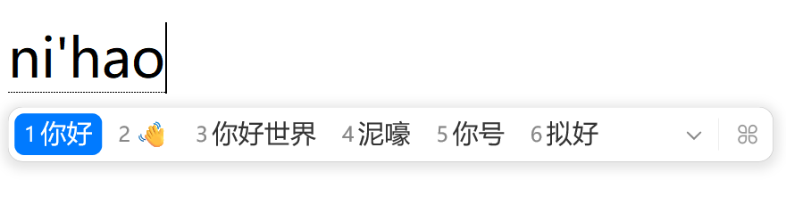

# 微信输入法候选框美化（颜色改变）

**把微信输入法候选框的强调色改成任意 `#RRGGBB`。**

写在最前面：微信输入法是一个很好用的输入法，但是美中不足的就是它默认的绿色真的看起来太难看了，而且官方没有做替换颜色的选项，为了解决这个在Windows端的问题，所以有了这个工具，有点偏逆向的感觉吧，有一个exe+skill，当版本更新时，skill可以提供出我做这个工具时候的思路，可以更快的进行适配，当然这个工具是个过渡期的工具，我相信未来的某一个版本微信输入法团队会加上自定义颜色/主题之类的功能。

微信输入法 PC 版的候选框只有一种绿色（`#00B176`），官方没有提供自定义入口。
这个工具通过字节签名定位候选框的 Direct2D brush 构造代码，只改写其中的颜色数据，
改完重启输入法即可生效——不常驻、不注入、不做覆盖层。



<div align="center">

**Rust CLI** · **原生 Windows GUI** · **Agent Skill**

</div>

> [!WARNING]
> **这是非官方社区工具，与腾讯无关。**
> 只从本仓库获取脚本和二进制，不要运行来源不明的同名程序。
>
> 打补丁会改写 `wetype_renderer.exe`，微信输入法的**数字签名会因此失效**
> （文件哈希不再匹配腾讯的原签名，系统可能提示“文件已更改”）。
> **更新或重装微信输入法前，请先执行“恢复原版”**，否则新版可能签名校验失败、无法正常更新。
> 请先备份，风险自负。

---

## 目录

- [效果](#效果)
- [快速开始](#快速开始)
- [命令行](#命令行)
- [工作原理](#工作原理)
- [版本兼容](#版本兼容)
- [Agent Skill](#agent-skill)
- [构建](#构建)
- [常见问题](#常见问题)
- [License](#license)

---

## 效果

| | |
|---|---|
| 默认 | 绿色 `#00B176`，没有自定义选项 |
| 修改后 | 任意 `#RRGGBB`，例如 `#007AFF` |

只改**候选框的选中项/强调色**。设置界面、其他功能、输入法本体逻辑都不受影响。

## 快速开始

> 需要 **Windows 10/11**，并已安装微信输入法 PC 版（已验证 3.0.2.44）。

1. 从 [Releases](https://github.com/ZhAOYuBo1/rainbow-wetype/releases) 下载 `rainbow-wetype-*-win-x64.zip` 并解压，保持这三个文件在**同一个文件夹**：

   ```text
   rainbow-wetype-gui.exe
   wetype-color.exe
   signatures.json
   ```

2. 双击 `rainbow-wetype-gui.exe`，会弹出 UAC（需要管理员权限）。
3. 程序会自动检测微信输入法目录；不对就点“浏览...”手动选（选到含 `wetype_renderer.exe` 的目录）。
4. 填一个 `#RRGGBB`，点 **“应用并重启输入法”**。
5. 回任意输入框打字，候选框就是新颜色了。
6. 想改回去，点 **“恢复原版”**（需要第一次应用时生成的备份）。

## 命令行

`wetype-color.exe` 是核心实现，GUI 只是它的外壳。所有命令输出 JSON。

```powershell
# 检测安装目录、版本、服务状态、备份状态（不需要管理员）
wetype-color.exe detect

# 扫描签名，确认能唯一定位（不需要管理员）
wetype-color.exe scan --signatures signatures.json

# 应用颜色（需要管理员）
wetype-color.exe apply --color "#007AFF" --dir "C:\Program Files\Tencent\WeType\3.0.2.44" --signatures signatures.json

# 读回文件核对当前颜色（不需要管理员）
wetype-color.exe verify --expect "#007AFF" --signatures signatures.json

# 恢复原版（需要管理员）
wetype-color.exe restore --dir "C:\Program Files\Tencent\WeType\3.0.2.44"
```

| 命令 | 作用 | 需要管理员 |
|---|---|---|
| `detect` | 查找安装目录 / 版本 / 服务 / 备份 | 否 |
| `scan` | 签名扫描，报告每个签名命中次数与当前颜色 | 否 |
| `apply` | 备份、停服务、改色、重启、读回验证 | **是** |
| `verify` | 读回当前颜色并和期望值比对 | 否 |
| `restore` | 从备份恢复原版 | **是** |

`--dir` 省略时自动检测；`--signatures` 省略时会在 exe 同目录、上级目录、当前目录里找 `signatures.json`。

## 工作原理

一句话：**用字节签名在 `wetype_renderer.exe` 里找到候选框 brush 的构造代码，只改写颜色数据。**

1. **定位**：候选框是原生 Direct2D 绘制的，强调色来自一个 `ID2D1SolidColorBrush`。
   在构造该 brush 的机器码附近取一段特征字节（opcode + 结构固定，颜色数字留 `??` 通配），
   存进 `signatures.json`。签名分两级：`exact`（原版精确字节，优先）→ `struct`（颜色与栈偏移通配，兼容已改过或布局轻微变化的版本）。
2. **校验**：扫描必须**唯一命中**才继续。命中 0 次或多于 1 次一律拒绝，绝不在歧义位置盲改。
3. **改写**：只写 8 个字节——R 是一个 `f32`（0..1），G/B 各有两个立即数（普通色 + 暗色）。
   **不修改任何 opcode**，所以绘制逻辑、分支结构保持原样。
4. **安全闭环**：第一次 `apply` 自动备份到 `%ProgramData%\WeTypeColor\backup\<版本>\`，
   然后停服务 → 只终止该安装目录下的进程 → 写文件（失败会重试）→ 重启服务 → 读回验证。
   写入失败会自动用备份回滚；颜色读回与预期不符时 `ok=false`，不会谎报成功。

内部细节（D2D brush 布局、RVA、假线索、新版本排查决策树）在
[`skill/references/reverse-engineering.md`](skill/references/reverse-engineering.md)。

## 版本兼容

- **已验证**：微信输入法 PC `3.0.2.44`（原版 `wetype_renderer.exe`
  SHA256 `18564AD61BD01DDA0ED4830A28D3508CD4C39B123BD0DA49C786982EC447995E`）
- **附近版本**：通常能靠 `struct` 签名命中；先跑 `scan` 看是否唯一命中，再 `apply`。
- **大版本重写绘制逻辑后**：签名可能失效，`scan` 会报 `supported=false`。这时**不要**改旧偏移硬写，
  按 [`reverse-engineering.md`](skill/references/reverse-engineering.md) 的决策树重新定位，把新签名追加到 `signatures.json`。
- **新增签名不需要重新编译**：CLI 每次运行都动态读取 `signatures.json`。

## Agent Skill

`skill/` 是一个自包含的 Agent Skill，把 detect → scan → apply → verify → restore 串成完整流程，
并附带逆向记录、签名说明和故障排查文档。脚本全部输出 JSON，适合 agent 解析。

```text
skill/
├── SKILL.md                  # 给 agent 的入口
├── scripts/                  # detect / scan / apply / restore / verify
├── tools/wetype-color.exe    # Rust CLI（动态读取 signatures.json）
└── references/
    ├── reverse-engineering.md   # 怎么定位的、假线索、新版本决策树
    ├── investigation-log.md     # 时间线与踩坑记录
    ├── signatures.md            # 签名格式与追加流程
    └── troubleshooting.md       # 常见故障
```

安装：把整个 `skill/` 目录复制为 `~/.agents/skills/rainbow-wetype`（或项目下的 `.agents/skills/`）。

> [!IMPORTANT]
> 仓库里的 `skill/` **不含** `tools/wetype-color.exe`（二进制不进 git）。
> 想让脚本直接可用，请从 [Releases](https://github.com/ZhAOYuBo1/rainbow-wetype/releases)
> 下载 **`rainbow-wetype-skill-*.zip`**，解压后就是带 `tools/wetype-color.exe` 的完整 skill。
> 也可以自己 `cargo build --release` 后把 `rainbow-wetype.exe` 重命名放到 `skill/tools/wetype-color.exe`。

```powershell
cd skill
powershell -NoProfile -ExecutionPolicy Bypass -File scripts/detect.ps1
powershell -NoProfile -ExecutionPolicy Bypass -File scripts/scan.ps1
powershell -NoProfile -ExecutionPolicy Bypass -File scripts/apply.ps1 -Color "#007AFF"
powershell -NoProfile -ExecutionPolicy Bypass -File scripts/verify.ps1 -Expect "#007AFF"
powershell -NoProfile -ExecutionPolicy Bypass -File scripts/restore.ps1
```

## 构建

```powershell
cargo build --release            # CLI → target/release/rainbow-wetype.exe
cd gui; cargo build --release    # GUI → gui/target/release/rainbow-wetype-gui.exe
```

GUI 构建需要 Windows SDK 的 `rc.exe`（`winres` 用来嵌入 manifest 和图标）；
如果 `cargo` 找不到，把 SDK 的 `bin\x64` 加进 `PATH`。
（Rust 构建出的 CLI 名为 `rainbow-wetype.exe`，发布时在 `release/` 里叫 `wetype-color.exe`。）

## 常见问题

**改了颜色但候选框没变？**
候选窗口不会热刷新。确认服务已重启，然后重新输入、让候选框重新弹出。
用 `verify --expect` 确认文件字节确实改了；字节对但界面不对，多半是改到了另一份安装。

**`administrator_required`？**
`apply` / `restore` 必须管理员。用管理员终端运行，或直接用 GUI（自带 UAC manifest）。

**`supported=false` / 找不到唯一签名？**
当前版本绘制逻辑不匹配已有签名。看 `scan` 输出里每个签名的命中次数，然后按逆向文档排查；不要扩大通配符乱试。

**文件被占用写不进去？**
工具会终止该安装目录下的 WeType 进程并重试。仍失败就检查安全软件拦截，或手动停掉 `WeType` 服务后重试。

**候选框显示异常 / 输入法坏了？**
立刻 `restore`。备份损坏的话只能重装微信输入法。**不要**继续在未知字节上试改。

**备份在哪？**
`%ProgramData%\WeTypeColor\backup\<版本>\wetype_renderer.exe.orig`。备份丢了就只能重装。

## 免责与边界

- 本项目**不包含**微信输入法原版二进制、备份文件或腾讯安装包。
- 修改第三方软件可能违反其用户协议；请在你拥有授权的设备上使用，并先备份。
- GUI 图标是基于微信输入法 logo 的本地设计。

## License

MIT，仅覆盖本项目的 Rust 源码、脚本和文档。
微信输入法、WeType、腾讯及相关商标与资源不属于本项目授权范围。
